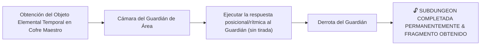

# Encuentros y Guardianes de Minos (Boss Design Framework)

> **Ubicación**: `7 - DM/OneShots/!RogueZeldaRepeat/04-Encuentros_y_Guardianes.md`  
> **Diseñado bajo el Marco Metodológico**: `boss-ability-design`  
> **Sistema de Combate**: **Zelda-Style Mini-Dungeon Bosses** + **Elemental Orbs & Full Burst** (Inspirado en *Xenoblade 2*).  
> **Palabras de Poder de Shivath**: **Fire**, **Water**, **Air**, **Earth**, **Life**, **Light**.

---

## 1. Guardianes de Área y Objetos Elementales de Subdungeon

En cada Subdungeon Elemental, los jugadores obtienen el **Objeto Elemental Temporal** en el Cofre Maestro. Es una **herramienta** para operar el gimmick de la arena — nunca un botón de victoria: el combate se resuelve con **observación, ritmo y posición**, sin tiradas que otorguen la victoria.



---

### Catálogo de Guardianes y Objetos Elementales

### A. El Señor del Crisol (Guardián de FIRE - La Caldera Volcánica)
* **Objeto Elemental Requerido**: *Guantelete de Llama* (Obtenido en el Cofre Maestro de la Caldera).
* **Mecánica Zelda (ritmo + posición)**: El escudo de escoria solo funde con los 3 braseros encendidos. Cada brasero prende únicamente durante el pulso visible de su conducto de magma, y el pulso avanza en un ciclo fijo I → II → III (una ronda por brasero). El Guantelete solo enciende un brasero si se dispara **desde su estación de tiro** durante su pulso. Sin tiradas: observar un ciclo, situarse y disparar a tiempo.
* **Peligro Kinético de Arena**: Geiseres de lava activa en el suelo al final de cada ronda (Reflejos DC 14 o 2d6 Fuego).
* **Recompensa**: 🔓 Desbloqueo permanente del paso por la Caldera y Fragmento de Tablilla #1.

---

### B. La Quimera Hidráulica (Guardián de WATER - La Cisterna Sumergida)
* **Objeto Elemental Requerido**: *Flauta del Mar*.
* **Mecánica Zelda (deducción + alternancia)**: La Quimera flota fuera del alcance sobre un chorro de agua. La flauta **no drena nada por sí sola**: tocar la melodía de las turbinas (orden de notas deducido de su zumbido, observable en un ciclo) desbloquea las 3 válvulas de drenaje. El drenaje exige **abrir alternativamente la válvula de la turbina que zumba en cada ronda** (el zumbido rota). Válvula correcta: drena un tercio de la columna; válvula repetida o errada: golpe de presión (2d6 contundente) y el último tercio se re-cimbra.
* **Peligro Kinético de Arena**: Corriente de succión en los desagües arrastra 15 ft hacia las cuchillas de turbina.
* **Recompensa**: 🔓 Desbloqueo permanente del paso por la Cisterna y Fragmento de Tablilla #2.

---

### C. El Coloso del Vértice (Guardián de AIR - La Torre de los Vientos)
* **Objeto Elemental Requerido**: *Capa del Vértice*.
* **Mecánica Zelda (timing deducible)**: Los tres tornados perimetrales ráfaguean en un ciclo visible de 3 rondas (dos de ráfagas y una de calma; la inversión del giro anuncia el hueco). Remontar con la Capa solo funciona en la ronda de calma. Lanzarse en ronda de ráfaga: el tornado te barre — **caída + pérdida de tempo** (2d6 de impacto, pierdes tu siguiente turno; Atletismo DC 13 al caer para agarrarte a un saliente o tardas una ronda extra en volver).
* **Peligro Kinético de Arena**: Corrientes ascendentes y pozos sin fondo; caer requiere tirada de Atletismo DC 13 para agarrarse al borde.
* **Recompensa**: 🔓 Desbloqueo permanente del paso por la Torre y Fragmento de Tablilla #3.

---

### D. El Titán de Basalto (Guardián de EARTH - El Dominio Telúrico)
* **Objeto Elemental Requerido**: *Martillo de Basalto*.
* **Mecánica Zelda (grietas persistentes + enfoque)**: El Martillo de Basalto abre una **grieta persistente** en una de las 3 zonas de coraza (hombro izquierdo, pecho, hombro derecho). Una zona agrietada recibe daño normal de forma indefinida. Pero al final de cada ronda, **toda zona agrietada que no haya recibido daño se resella** (la coraza regenera si no la enfocas). No hay ventana fija de 1 ronda: la exposición se sostiene con foco sostenido, no con un turno afortunado.
* **Peligro Kinético de Arena**: Derrumbes de estalactitas telúricas tras cada impacto sismológico (Fuerza DC 14 o quedar apresado).
* **Recompensa**: 🔓 Desbloqueo permanente del paso por el Dominio y Fragmento de Tablilla #4.

---

### E. El Botánico de Sombras (Guardián de LIFE - El Invernadero Ancestral)
* **Objeto Elemental Requerido**: *Semilla Botánica*.
* **Mecánica Zelda (tell de esporas + terreno seguro)**: Los 4 bulbos esporean en un ciclo fijo N → E → S → O; el bulbo que esporea abre sus mandíbulas la ronda siguiente (tell observable). El aliento del Botánico prende esas esporas y chamusca ese montículo: **la semilla solo prende en suelo no quemado** y las vides solo traban bulbos abiertos. La maraña brota al inicio de la ronda siguiente y repta 1 sector por ronda: el timing correcto traba los cuatro bulbos en una sola vuelta y expone la flor central. Mal timing: vides enredadas en un bulbo cerrado — intento malogrado, recuperar la semilla y esperar la próxima vuelta del ciclo.
* **Peligro Kinético de Arena**: Nubes de esporas venenosas (Constitución DC 13 o Envenenado) que se inflaman al contacto con fuego.
* **Recompensa**: 🔓 Desbloqueo permanente del paso por el Invernadero y Fragmento de Tablilla #5.

---

### F. El Espejismo de Cristal (Guardián de LIGHT - El Santuario Prismático)
* **Objeto Elemental Requerido**: *Escudo Prismático*.
* **Mecánica Zelda (cadena posicional de reflejos)**: Equipar el *Escudo Prismático* **no basta**: solo captura el haz del tragaluz en la peana central. El haz debe encadenarse por 2-3 **espejos de pared** con runas numerales (I → II → III): cada espejo gira cuando alguien se planta en su runa gemela del suelo. La cadena fija el rayo sobre la figura verdadera (las copias no refractan el haz). Mientras la cadena se sostiene (portador + vigías en sus runas), el Espejismo queda revelado y clavado; rota la cadena, el haz se dispersa y las copias se reforman en 1 ronda.
* **Peligro Kinético de Arena**: Rayos cegadores refractados en las paredes (Sabiduría DC 13 o Ceguera por 1 ronda).
* **Recompensa**: 🔓 Desbloqueo permanente del paso por el Santuario y Fragmento de Tablilla #6.

---

## 2. BOSS FINAL: El Juicio de Minos (Equilibrio de Nivel Fijo)

```
=====================================================================
          👑 EQUILIBRIO Y DIFICULTAD DEL BOSS FINAL 👑
=====================================================================
- ACCESO: la Gran Puerta Hexagonal del Sanctum 12 exige los
  6 Fragmentos de Tablilla. Es el ÚNICO item-gate de la run:
  ninguna tirada (Arcanos DC 14 incluida) abre esa puerta.
- NIVEL FIJO RECOMENDADO: Nivel 7 - 8.
- BALANCE DE GRUPO: Diseñado exactamente para un grupo de CINCO (5)
  personajes equipados con al menos 5 de las 6 Palabras de Poder / Elementos.
- DESAFÍO: Leer los tells elementales, ejecutar la respuesta ambiental
  posicional (sin tirada) y romper los orbes en el orden oculto
  (Vida → Luz → Tierra → Aire → Fuego → Agua) para desatar el FULL BURST.
=====================================================================
```

---

## 3. Mecánica Detallada de los Orbes Elementales (Xenoblade 2 System)

> **La regla no se explica a los jugadores**: se descubre observando el primer ciclo fallido del reactor al alinear los anillos (ver `01_Sanctum_12_El_Juicio_de_Minos.md`, 🔒 Ciclo Fallido Inicial).

### A. Generación de Orbes (respuesta ambiental al TELL — sin tirada)
Al inicio de cada ronda, *El Juicio de Minos* emite un **TELL elemental** (destello, zumbido, vapor, retumbo...). Cada consola perimetral responde a un elemento: si los jugadores accionan la consola del elemento del tell antes de que cierre la ronda, **sin tirada**, el **Orbe** de ese elemento se manifiesta sobre esa consola.

* **Tipos de Orbes**: `Fire Orb`, `Water Orb`, `Air Orb`, `Earth Orb`, `Life Orb`, `Light Orb`.
* **El Orbe NO es un buff del boss**: no otorga AC, ni inmunidades, ni auras, ni contraataques. Es un **recurso táctico del grupo**: mientras exista, intercepta los ataques del Juicio de su mismo elemento (escudo posicional).
* Si los jugadores no responden al tell, el ataque del Juicio se resuelve con normalidad contra la arena.

---

### B. Ruptura de Orbes (condición posicional + orden oculto)

Un orbe se rompe cuando **el ataque del Juicio del elemento opuesto a su elemento lo atraviesa**. Coloca un señuelo en la línea entre el Juicio y el orbe objetivo para arrastrar el ataque por encima del orbe.

El orden de cadena está **OCULTO** (no lo anuncies): **Vida → Luz → Tierra → Aire → Fuego → Agua**. Se deduce del ciclo fallido del reactor (revela el arranque Vida → Luz) y de las marcas de detonación de las seis consolas (las más quemadas son los primeros eslabones tras Luz).

| Orden de Cadena | Orbe Objetivo | Debe atravesarlo un ataque de | Efecto al Romperse |
| :---: | :--- | :---: | :--- |
| **I** | **LIFE (Vida)** | **LIGHT (Luz)** | Purificación luminosa; sana 2d8 HP al grupo aliado. |
| **II** | **LIGHT (Luz)** | **LIFE (Vida)** | Absorción vegetal; ciega temporalmente al boss (1 ronda). |
| **III** | **EARTH (Tierra)** | **AIR (Aire)** | Pulverización de viento; rompe la armadura de roca. |
| **IV** | **AIR (Aire)** | **EARTH (Tierra)** | Aplastamiento de presión; derriba al boss **Prone**. |
| **V** | **FIRE (Fuego)** | **WATER (Agua)** | Explosión de vapor; funde la coraza ígnea. |
| **VI** | **WATER (Agua)** | **FIRE (Fuego)** | Evaporación desestabilizadora; el reactor marca el colapso. |

* **Orden erróneo**: el orbe detona parcialmente (**4d6** del elemento del orbe en radio de 15 ft: coste real en daño y tempo), el orbe se reforma al inicio de la ronda siguiente y la cadena de anillos NO avanza.

---

### C. Sobretensión de Cadena: FULL BURST (Ruptura Total)

```
=====================================================================
               ⚡ FULL BURST: SOBRETENSIÓN DE MINOS ⚡
=====================================================================
1. ¡ROMPIMIENTO TOTAL!: los 6 Orbes detonan en cadena, en el orden
   correcto (Vida → Luz → Tierra → Aire → Fuego → Agua).
2. STUN COMPLETO: El Juicio de Minos queda ATURDIDO durante 1 RONDA.
3. RECURSO PERDIDO: los orbes ya no interceptan los ataques del Juicio.
4. DAÑO CRÍTICO MULTIPLICADO: Todos los ataques de los jugadores durante 
   esta ronda asestan DAÑO CRÍTICO AUTOMÁTICO MULTIPLICADO (x2).
=====================================================================
```

---

## 4. Distribución Diaria de Salas de Combate (Nuevo Tipo de Sala Dedicada, 20-50%)

> **Regla Core de Encuentros**: Las **Salas de Combate (`role: COMBAT`)** son un **nuevo tipo de sala dedicada e independiente** dentro de la rejilla 7x7. Se ubican en posiciones físicas separadas de las salas de puzles/gimmicks (no se superponen ni reemplazan otras salas).

### A. Proporción Diaria y Posicionamiento Independiente
* **Porcentaje Diario**: Entre el **20% y el 50%** de las salas activas del mapa diario son generadas como **Salas de Combate Dedicadas** (`⚔️ Sala de Combate`).
* **Autonomía Espacial**: Ocupan sus propias celdas en la topología de la rejilla 7x7 y cuentan con su propio identificador y mapa visual con la etiqueta `⚔️ CR X`.

### B. Distribución de Dificultad (CR 3 - 7, Cap Máximo CR 7)
La dificultad de los encuentros aleatorios en las salas de combate dedicadas está **acotada estrictamente hasta un máximo de CR 7 (CR 3 a CR 7)** para garantizar encuentros ágiles y desafiantes sin riesgo de TPKs injustos por picos desproporcionados:

| Rango de Desafío | Probabilidad Estimada | Tipo de Criaturas del Laberinto |
| :---: | :---: | :--- |
| **CR 3 - 4** | ~30% (Ligero) | Enjambre de Escarabajos Magmáticos, Espectros de Bronce, Minotauro Joven |
| **CR 5 - 6** | ~45% (Estándar) | Minotauro del Laberinto, Golem de Piedra Rúnico, Quimera Vulcánica |
| **CR 7 (CAP MÁXIMO)** | **~25% (Pico de Desafío)** | **Guardián Mecánico de Minos, Titán de Granito Telúrico, Minotauro Berserker** |

---

### C. Catálogo de Tipos de Arenas de Combate y Gimmicks Ambientales (1d6)

Cada Sala de Combate Dedicada cuenta con una **topología de arena específica** con peligros tácticos y elementos interactivos que los jugadores pueden utilizar a su favor:

| 1d6 | Tipo de Arena de Combate | Gimmick Ambiental Táctico | Uso Creativo por Jugadores |
| :---: | :--- | :--- | :--- |
| **1** | **Arena del Foso de Contrapesos** | Péndulo pesado de basalto oscilando en el centro (daño 2d10 contundente a quien ocupe la línea central en iniciativa 20). | Empujar o cortar la soga para soltar el contrapeso directamente sobre los enemigos (DC 13 Fuerza/Atletismo). |
| **2** | **Arena de las Geodas Inestables** | Pilares de cristal telúrico que resuenan con la vibración del combate y explotan al recibir impacto (3d6 daño de fuerza en área 15 ft). | Provocar o empujar a los monstruos hacia las geodas antes de detonarlas a distancia con proyectiles. |
| **3** | **Arena del foso de Rejas Retráctiles** | El suelo alterna entre placas firmes y rejas metálicas que se abren cada ronda par revelando un abismo de estacas. | Posicionarse estratégicamente o usar empujes/agarres (Shove/Grapple) para hacer caer enemigos al abismo. |
| **4** | **Arena de los Muros Reflectantes** | Muros de cuarzo pulido que duplican y desvían los proyectiles mágicos y flechas en ángulos de 90°. | Apuntar disparos a las paredes para bordear la cobertura de los enemigos o lograr impacto por la espalda. |
| **5** | **Arena de la Pasarela Suspendida** | Combate en un puente angosto de 10 ft de ancho sobre una sima sin fondo. Terreno difícil y viento cruzado. | Habilidades de control de masas (Ráfaga de Viento, Empujón) son letales para limpiar enemigos rápidamente. |
| **6** | **Arena del Altar de Sintonía** | Monolito central que otorga +2 AC y resistencia al elemento del día a la criatura que permanezca en su peana de 5 ft. | Disputar la peana central con maniobras físicas para despojar al enemigo del buff defensivo. |

---
